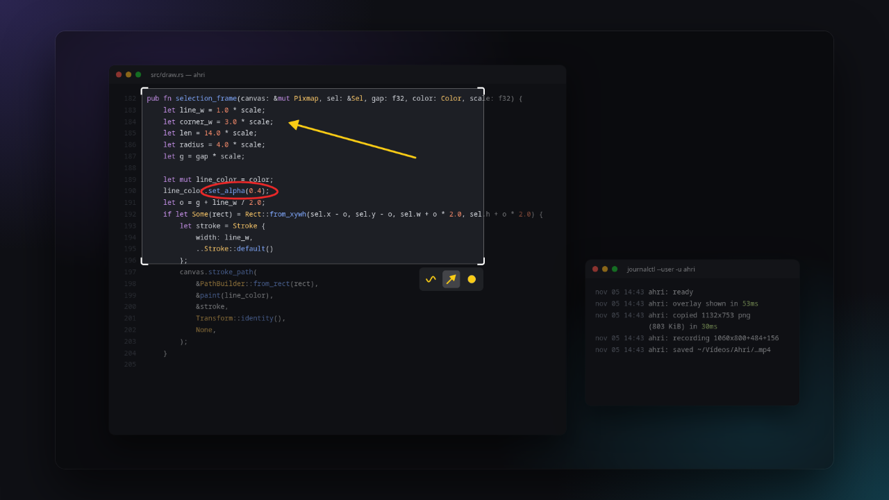
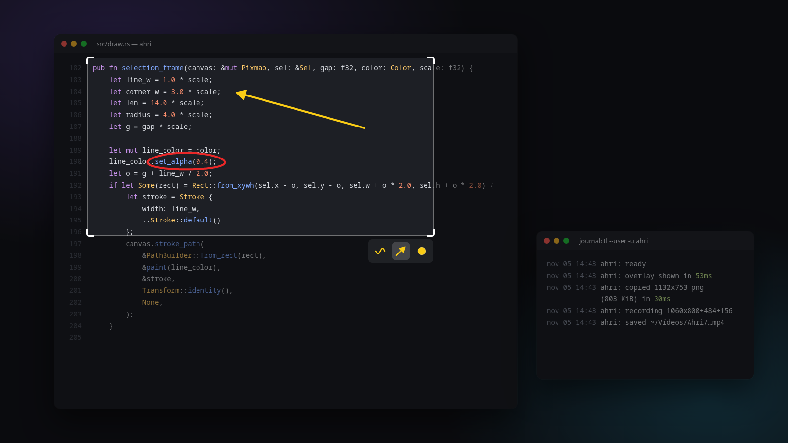
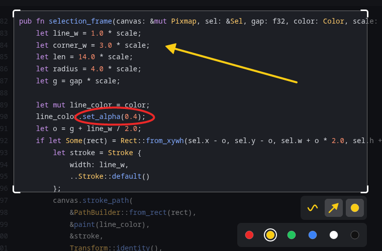
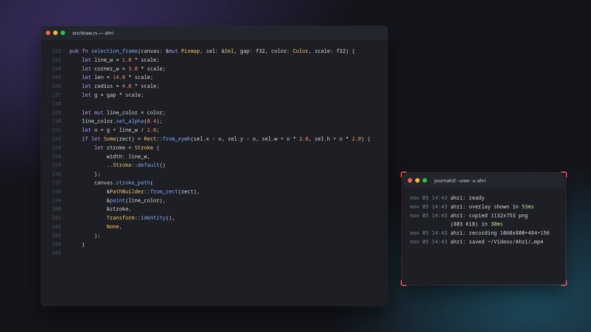

<div align="center">


# Ahri

**Print e gravação de tela para KDE Plasma no Wayland.**<br>
Um daemon em Rust que abre na hora e copia direto para o clipboard.


<br>



</div>

<br>

## Destaques

- **Abre em cerca de 50 ms.** O daemon já está rodando, e a tela vem direto do KWin, sem diálogo de permissão.
- **Copia na hora.** O PNG vai para o clipboard em cerca de 30 ms. O vídeo vai como arquivo, pronto para colar.
- **Só 2 ferramentas.** Desenho livre e seta, em 6 cores. Nada de menus.
- **Leve.** Sem Qt nem GTK: o overlay é uma janela layer-shell desenhada na CPU.

## Print

Aperte <kbd>Win</kbd> <kbd>Shift</kbd> <kbd>S</kbd>. A tela congela. Arraste uma área, marque o que importa e aperte <kbd>Ctrl</kbd> <kbd>C</kbd>.

<table>
  <tr>
    <td></td>
    <td></td>
  </tr>
  <tr>
    <td align="center"><sub>Traço livre e seta dentro da área</sub></td>
    <td align="center"><sub>Paleta com 6 cores</sub></td>
  </tr>
</table>

| Tecla | Ação |
| --- | --- |
| <kbd>1</kbd> ou <kbd>A</kbd> | Desenhar |
| <kbd>2</kbd> ou <kbd>D</kbd> | Seta |
| <kbd>3</kbd> | Abrir as cores, depois <kbd>1</kbd>–<kbd>6</kbd> para escolher |
| <kbd>C</kbd> | Próxima cor |
| <kbd>Ctrl</kbd> <kbd>Z</kbd> | Desfazer |
| <kbd>Ctrl</kbd> <kbd>C</kbd> ou <kbd>Enter</kbd> | Copiar e fechar |
| <kbd>Esc</kbd> | Cancelar |

Arraste as bordas ou os cantos para redimensionar a área. Cada traço guarda a própria cor, e todo print começa em vermelho.

## Gravação

Aperte <kbd>Win</kbd> <kbd>R</kbd> e arraste uma caixa. A gravação começa quando você solta o mouse.

Aperte <kbd>Win</kbd> <kbd>R</kbd> de novo para parar. O vídeo vai para `~/Vídeos/Ahri/`, e o arquivo já fica no clipboard para colar no Discord, no navegador ou no gerenciador de arquivos.

<p align="center"></p>

A moldura fica fora da área gravada e não bloqueia cliques.

## Instalação

Precisa de KDE Plasma 6 no Wayland, Rust e [gpu-screen-recorder](https://git.dec05eba.com/gpu-screen-recorder/about/).

```sh
sudo pacman -S gpu-screen-recorder
git clone https://github.com/juicerq/ahri
cd ahri
./install.sh
```

O script instala o binário em `~/.local/bin`, registra o Ahri no KWin e liga um serviço systemd de usuário. <kbd>Win</kbd> <kbd>Shift</kbd> <kbd>S</kbd> e <kbd>Win</kbd> <kbd>R</kbd> passam do Spectacle para o Ahri. O Spectacle continua no <kbd>Print</kbd> e no <kbd>Win</kbd> <kbd>Shift</kbd> <kbd>R</kbd>.

<details>
<summary>Remover</summary>

```sh
systemctl --user disable --now ahri
rm ~/.local/bin/ahri ~/.local/share/applications/ahri.desktop \
   ~/.local/share/icons/hicolor/scalable/apps/ahri.svg ~/.config/systemd/user/ahri.service
```

</details>

## Por baixo

| Parte | Como |
| --- | --- |
| Captura | `org.kde.KWin.ScreenShot2`, liberado pelo `.desktop` |
| Overlay | layer-shell com [smithay-client-toolkit](https://github.com/Smithay/client-toolkit) e [tiny-skia](https://github.com/linebender/tiny-skia) |
| Atalhos | kglobalaccel por D-Bus |
| Clipboard | `ext-data-control`, servido pelo próprio daemon |
| Gravação | `gpu-screen-recorder` em H.264, na GPU quando dá e na CPU quando não dá |

<br>

<div align="center">
<sub>O nome é uma homenagem à Ahri, minha gatinha.</sub>
</div>
